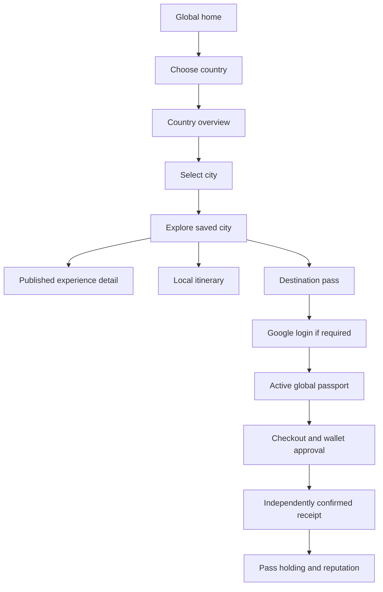

# Application flows and route map

Source reviewed 2026-10-21. Replace `[locale]` with `es`, `en`, or `pt`. Persistent application data lives in Supabase unless explicitly marked browser-local. This is an implemented-flow guide; pilot acceptance limits are in [VERIFICATION.md](VERIFICATION.md).

## Visitor discovery

Home introduces CityPassport independently of a saved city. `/[locale]/destinations` lists countries; `/[locale]/destinations/br` illustrates a country overview, while longer validated city slugs open destination detail. Selecting a city validates the registry and persists `citypassport_destination`; `/[locale]/explore` uses it. The default is Puerto Iguazú when available, then the first registry city. Locale changes retain permitted public context, excluding credential parameters.

A city selection filters discovery and workspaces, never grants staff rights. Passport history remains global. External provider links leave the application and do not create a reservation, confirm availability, or prove partnership. Itinerary saves and reward interests are local browser state.

## Account and passport

1. Anonymous passport CTAs open `/[locale]/login`. Existing active accounts open their passport; legacy inactive accounts can activate it.
2. Pollar Google login provisions/restores a managed Stellar wallet. Browser provider state is insufficient for application access.
3. A server action verifies the token; a database transaction establishes the profile, global traveler, and hashed application session. It does not merge legacy accounts by email.
4. The page reloads to refresh account-dependent navigation. `/[locale]/passport` shows actual stamps, acquired passes, reputation, and recent purchase recovery.
5. The stamp book groups verified claims by city, four per page. Anonymous sample animation never counts as a visit. Logout revokes the app session before clearing provider state.

Database activation and public on-chain activity activation are different. The current app only performs database activation.

## Visit stamp

Authorized staff issue/revoke QR credentials for approved participation. A traveler opens `/[locale]/claim` or uses the camera/manual input, then confirms the claim. The fragment is removed from browser history. The server validates the token, and PostgreSQL checks session, activation, active stamp, organization/venue participation, credential validity/capacity, throttling, and duplicate collection. It creates a missing destination collection and claim atomically. Invalid codes grant nothing. Sign in before rescanning rather than persisting credentials through OAuth.

## Destination pass purchase and recovery

1. A destination offer links to a purchase action. The current development offer is exactly 100 testnet USDC, with +80 reputation after settlement and no venue perks.
2. The action requires a verified account, active global passport, testnet wallet, published approved offer, and configured treasury. Existing ownership is rejected; an unfinished purchase is reused.
3. The buyer must differ from the receiving wallet. A receiving-account session is offered an account switch.
4. The action redirects to `/[locale]/checkout/[id]`. The checkout reviews the frozen merchant/product/amount; the server checks buyer funds and recipient trustline capacity.
5. Pollar prompts for signature. The server validates XDR and stores its envelope/hash before broadcast. A pending provider result grants no holding.
6. Independent Stellar confirmation creates one immutable receipt; the same database transaction creates the pass and reputation event. Passport tiers are Basic 0–79, Mid 80–239, Top 240+.
7. If interrupted, open the passport's recent purchase history and return to the checkout. Check status or retry the **same** stored envelope. Unknown settlement remains submitted; do not create a replacement payment just because the network lookup failed.

One lifetime pass per traveler/destination is enforced. There is no renewal, refund, transferable token, financial conversion, or enabled reward redemption. [Settlement details](STELLAR_INTEGRATION.md).

## Wallet and swaps

`/[locale]/wallet` requires a verified app/provider session and ready managed Stellar wallet. Pollar supplies balance, receive QR, send, and history modals. Swap is enabled only when provider configuration returns venues. The modal controls quote choice/signing. A wallet transfer or swap does not fulfill a CityPassport checkout. No automatic conversion is attempted when checkout lacks USDC. [Swap behavior](SWAPPING.md).

## Hotel and guest

1. A verified user creates a pending hotel organization at `/[locale]/hotel`, receiving an owner membership.
2. Authorized owner/manager/receptionist creates reservations in that hotel and issues a single-use invitation. Private preparation does not require public participation approval.
3. Staff manually share the link through their existing channel; CityPassport sends no email/message.
4. `/[locale]/precheckin#token=…` is a generic guest form with no reservation PII read. The guest submits the token, matching reservation email, required fields, and explicit consent; no passport login is required.
5. PostgreSQL consumes the invitation and saves submission atomically. Hotel staff review and advance `submitted → reviewed → ready_for_arrival → completed`; cancellation invalidates invitations.

Other hotels, tourists, merchant reviewers, and catalog editors cannot access these records. Invitation timing, failed-email limits, and manual retention are described in [hotel pre-check-in](HOTEL_PRECHECKIN.md).

## Merchant, reviewer, and editor

Merchants onboard at `/[locale]/merchant` as pending organizations. Explicitly assigned destination reviewers use `/[locale]/review` to approve, suspend, or reactivate with reason, expected version, and idempotency protection. An approved owner configures a payout from their verified wallet. Authorized staff create a fixed checkout QR. A signed-in buyer scans at `/[locale]/pay`, reviews, signs, and follows the same independent receipt path. Merchant checkout does not automatically create pass ownership unless linked to a destination-pass order.

Experience editors use `/[locale]/operator` and `/[locale]/operator/[id]` through separately provisioned destination assignments. They create multilingual drafts, publish, withdraw, and save withdrawn records back to draft. Public `/[locale]/experiences/[id]` explicitly requires published status. Editing public content requires withdrawal first. Neither merchant review nor hotel ownership grants editor permission.

## Route inventory

| Route below `/[locale]`                                                  | Purpose/access                                                             |
| ------------------------------------------------------------------------ | -------------------------------------------------------------------------- |
| `/`, `/destinations`, `/destinations/[slug]`, `/explore`                 | Public discovery; registry content requires database configuration         |
| `/experiences/[id]`                                                      | Published catalog content; optional external provider link                 |
| `/login`, `/profile`, `/wallet`                                          | Pollar access, account controls, wallet                                    |
| `/passport`, `/claim`                                                    | Global passport and authenticated stamp claims                             |
| `/routes`, `/rewards`                                                    | Route planning and reward interests; local-only preferences; no redemption |
| `/hotel`, `/precheckin`                                                  | Tenant-private staff portal; anonymous write-only guest capability         |
| `/merchant`, `/pay`, `/checkout/[id]`                                    | Merchant workspace, scanner, authorized checkout/receipt                   |
| `/review`, `/operator`, `/operator/[id]`                                 | Separate destination reviewer/editor scopes                                |
| `/partners`, `/privacy`                                                  | Participation information and privacy copy                                 |
| `/inquiries`, `/inquiries/new`, `/inquiries/[id]`, `/operator/inquiries` | Retired application routes: 404; private subsystem remains                 |

`/auth/callback` is a legacy redirect to Pollar profile access; it no longer exchanges Supabase OAuth credentials. Unlocalized entry routes redirect to localized pages. Business workspaces require their specific database permissions even when a route is reachable.
