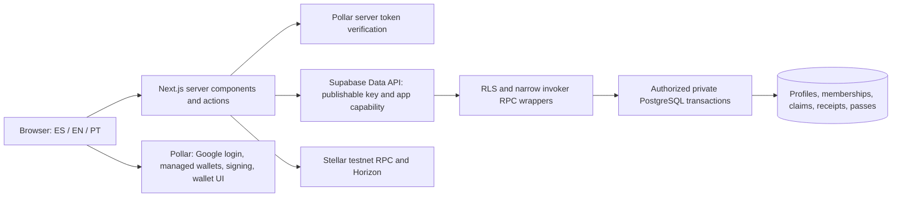

# Application architecture

Current source review: 2026-10-21. This replaces the original first-milestone architecture. **Pollar is the only application login**; Supabase Auth OAuth/PKCE is retired. Historical verification and remote migration claims live in [VERIFICATION.md](VERIFICATION.md) and [DATABASE_CONNECTION.md](DATABASE_CONNECTION.md).

## System boundaries

Next.js App Router, React, strict TypeScript, Tailwind 4, next-intl, Zod, and React Hook Form implement the web application. Server components are the default. Client components handle camera access, local preferences, interactive passport graphics, provider authentication, and signing. See [integration inventory](INTEGRATIONS.md) for pinned package versions and unused/planned dependencies.

The application has no separate REST backend. Domain mutations use server actions and named PostgreSQL RPCs. Supabase is the only application persistence backend; browser-local itinerary/reward-interest state has no claim of account synchronization. PGlite is exclusively a test database.

## Request, identity, and authorization

`src/proxy.ts` overwrites internal locale/path headers and emits `Cache-Control: private, no-store`. Localized pages are under `src/app/[locale]`; entry routes redirect into that structure. All application-visible copy belongs in `messages/{es,en,pt}.json`.

The lazy Pollar client authenticates through Google. `exchangePollarSession` verifies its token at Pollar's backend, validates the response, and signs a short-lived assertion. PostgreSQL upserts `user_profiles` by provider application/subject, creates the global traveler if necessary, and stores a hash of a new random capability. Cookie `citypassport_session` is HttpOnly/SameSite=Lax, Secure on HTTPS, and bounded by provider expiry or one hour.

The request-scoped Supabase client uses the publishable key and carries the capability in `x-citypassport-session`. `private.current_actor()` resolves a live, non-revoked hash. **JWT subject/metadata alone never grants application access.** Membership and scoped reviewer/editor assignments live in database tables. Legacy identities retain UUIDs and are not merged by email. Logout revokes the database capability; the client serializes exchanges and logout. [Pollar protocol](POLLAR_INTEGRATION.md) describes replay/rotation details.

Public tables have RLS and explicit grants. Private tables have default-deny access. Public mutation wrappers use invoker security and delegate to explicitly authorized private functions with pinned search paths. PostgreSQL repeats critical input, ownership, state, and destination invariants. Shared-resource locks, unique constraints, immutable command records, and private audit events protect accepted transitions. No direct client claim, ledger, receipt, invitation, or membership writes exist.

## Domain modules

| Module             | Main implementation                                                    | Persistence and boundary                                                                            |
| ------------------ | ---------------------------------------------------------------------- | --------------------------------------------------------------------------------------------------- |
| Directory/context  | `src/lib/destinations.ts`, `destination-context/`, destination actions | Public country/city registry; validated HttpOnly city cookie; browsing context never authorization  |
| Passport/QR/hotel  | `src/app/actions.ts`, `src/lib/validation.ts`                          | `passport_command`; global identity, destination collections, claims, tenant-private guest workflow |
| Merchant checkout  | `src/lib/payments/`, checkout actions                                  | Snapshot requests, private signed attempts, independent ledger verification, immutable receipts     |
| Destination passes | `src/lib/passes/`, `src/app/pass-actions.ts`                           | Published offers, private orders, receipt-triggered holdings/reputation                             |
| Business review    | Review actions and validation                                          | Explicit destination reviewer assignments; versioned audited decisions                              |
| Experiences        | Operator actions, `src/lib/experiences/`                               | Explicit editors; draft/published/archived lifecycle; no internal booking                           |
| Inquiries          | Retained migrations and `src/lib/inquiries/`                           | Private RPC/history retained; application routes return 404                                         |

Discovery has a curated editorial catalog when unconfigured. Configured query failures surface errors/unavailable states rather than fabricated live data. Fifteen sourced listings are recorded in the development history; listing status alone grants no participation. The isolated demo is labeled and cannot imply a real provider.

## Payments and consistency

Pollar signs; the server builds and verifies. Checkout is currently a classic **testnet USDC payment**, not a call to the local Rust contract. The server freezes source/destination, issuer, amount, memo nonce, and deadline; validates signed XDR; persists it before broadcast; and independently reads Stellar settlement. Domain-separated HMAC evidence reaches a locked private database transaction. Browser callbacks cannot create receipts.

A pass receipt transaction also inserts one immutable holding and +80 reputation. Uniqueness prevents duplicate receipt use and repeated destination ownership. Reputation is separate from the planned spendable loyalty ledger. Submitted/unknown transactions award nothing and remain recoverable. See [Stellar flow](STELLAR_INTEGRATION.md) and [checkout contract](API_REFERENCE.md).

## Agent purchase rail

The optional x402 testnet API uses a separate, short-lived traveler-authorized capability for one pass and one agent payer. It freezes the beneficiary wallet, persists a signed SAC transfer before facilitator settlement, independently verifies chain success and the exact original authorization, then uses the existing receipt fulfillment transaction. Unknown settlement outcomes block replacement charges; recovery can bind only a proven original transaction. Private tables have RLS and no client grants; public invoker wrappers require a live owner session or domain-separated backend proof plus the purchase capability. This rail is enabled in the user-approved local development setup; the migration and hosted denial/replay checks passed, while a funded agent purchase remains unverified. Fixed USDC offers do not use Reflector conversion. See [x402 operations](X402.md).

## Private hotel data and QR capabilities

Hotel membership scopes every reservation/submission read and mutation. Guests have no reservation lookup endpoint: a one-time invitation plus matching email permits submission only. Tokens are high-entropy secrets carried in URL fragments and stored as hashes. Reissue revokes earlier links. Submission consumes the invitation and advances the reservation atomically. Retention cleanup is a manual script, not a scheduled service.

Stamp claims lock the account limiter and QR credential, then verify participation, expiry, revocation, destination, capacity, activation, and uniqueness. Valid claims create a destination collection if needed. Static QR stamps prove neither purchase nor physical presence. See [QR security](QR_SECURITY.md) and [hotel workflow](HOTEL_PRECHECKIN.md).

## Chain integration boundaries

- **Pollar:** current identity, managed wallet, signing, and provider swap UI.
- **Stellar SDK/RPC/Horizon:** current payment construction, account/trustline preflight, broadcast, and independent confirmation.
- **Reflector:** installed dependency only; no current oracle read or FX conversion. [Integration plan](REFLECTOR_INTEGRATION.md).
- **Swaps:** Pollar-managed configured venues; no direct Soroswap SDK integration or automatic swap-to-checkout flow. [Swap guide](SWAPPING.md).
- **Passport activity contract:** deployed testnet contract (SDK 29.0.1), issuer-sponsored registration and automatic publishing from a private transactional outbox. The Node app starts a durable worker, authenticated by a fresh HMAC and coordinated through a global database lease. The passport reads confirmed reputation/stamp totals from Stellar and automatically refreshes pending activity. PostgreSQL remains responsible for source acceptance, pass holdings and private workflows; its reputation journal is not the displayed chain reputation. See [operations](ACTIVITY_CONTRACT.md).

## Delivery and verification

Functional changes require typecheck, unit, embedded DB, build, and browser suites. Hosted read-only checks and rolled-back SQL scripts provide additional evidence, not multi-user browser or independent-connection concurrency proof. Existing logs record a successful funded testnet pass and receipt recovery; this documentation update does not repeat that transaction. Production deployment, mainnet migration, contract deployment, funded swaps, automated reconciliation, refunds, reward redemption, and retention automation remain separate work. Deployment requires user approval.
