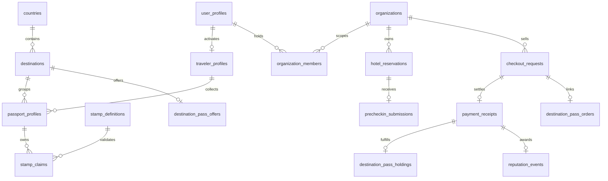

# Data model

## Implemented tables

- destinations: UUID, unique slug, display name, country and IANA timezone.
- organizations: destination, hotel/merchant/operator kind, pending/approved/suspended state. Public listings do not reveal member information.
- organization_members: composite organization/user key, constrained role, user lookup index. Application has read-own permission only; membership writes require trusted administration.
- venues: destination, optional organization, localized description, source URL, listed/participating/suspended state.
- passport_profiles: one passport per user and destination.
- stamp_definitions: venue and destination bound by composite FK, category, tier, active flag.
- private.qr_credentials: hashed secret, stamp FK, expiry, revocation and bounded usage counter. Never a public read.
- stamp_claims: one claim per passport/stamp, composite destination FKs, verification method and timestamp. Immutable to clients.
- routes / route_stops: localized routes and ordered venue stops; composite destination consistency. Completion progress is computed from owned claims. Automatic completion awards are not implemented.
- hotel_reservations: tenant/reference uniqueness, dates, bounded guest count, normalized email and operational state. Organization/arrival index.
- private.precheckin_invitations: hashed secret, reservation, expiry, consumed/revoked timestamps, failed email attempts.
- precheckin_submissions: one per reservation, composite tenant FK, minimal guest fields, consent timestamp and retention deadline.
- private.rate_limits: per-user stamp attempt window protected by row lock.
- private.audit_events: mutation type, actor, organization, entity and timestamp. Excludes token values, email and submitted payloads.
- points_ledger: append-only accounting groundwork with funding organization, signed integer delta, event kind, unique funding/reference idempotency and optional expiry. Mutation trigger rejects update/delete even by privileged ordinary writes. No transactional earning API yet.

All tables enable RLS. Schema migration carries explicit privileges, constraints and indexes. Public tables grant SELECT only, scoped by RLS. Business mutations go through the domain-specific invoker wrappers listed in [API_REFERENCE.md](API_REFERENCE.md); `passport_command` covers passport, QR, and hotel operations. Private functions use a pinned empty search path and fully qualified objects. Raw tokens are generated by Node crypto and sent only to the authorized recipient or operator response.

## Planned normalization

Separate loyalty_programs, earning_rules, rewards, purchase_verifications, reward_redemptions and route_completions before Phase 4. Experiences and private inquiries are already represented by the implemented tables below; inquiry application screens have since been retired. Separate operator business entities and any future confirmed booking model remain product work. Avoid placeholder tables that suggest operational readiness. Do not conflate hotel guest submissions with tourist profiles.

## Consistency

Claim operation locks user limiter then credential; uniqueness spans credential rotation. Hotel operations lock reservation before invitation to maintain a shared lock order. Reissue revokes earlier unconsumed invitations. Valid business rejection returns a JSON error so attempt counters commit. Malformed SQL payload errors roll back the transaction; server Zod validation handles these at the application boundary.

## CityPassport global identity extension

`traveler_profiles(id,user_id,created_at)` is unique per application user (`user_profiles.id`) and readable only by that user. `passport_profiles.user_id` now also references `traveler_profiles.user_id`, making each existing destination passport a collection under the global identity. Original collection IDs and destination constraints remain intact; stamp claims and ledger entries retain their original references. Global activation is independent of destination, and accepted claims can create destination collections transactionally. There is no client write grant on global profiles and no wallet secret/address field in this migration.

## Pollar user registry and application sessions

The current application identity registry is `public.user_profiles`, with an internal UUID and a unique nullable `(pollar_application,pollar_subject)` pair. Legacy IDs remain preserved and unassigned to an external identity. Organization memberships, global travelers and destination passports now reference this registry. Only server-verified Pollar profile data can update email, display name and wallet metadata; client mutation grants are absent. Email is not an identity key.

`private.app_sessions` stores only the hash of a random application capability, its user ID, expiry, revocation and creation times. `private.pollar_bridge_config` stores the backend assertion-verification key, not wallet keys. Both tables are inaccessible to direct client reads/writes and the private schema remains unexposed. `private.current_actor()` resolves valid capabilities for RLS and narrow transactional wrappers. A direct Supabase Auth JWT without that capability is not an application session.

## Merchant payment records

`merchant_payouts` stores verified owner wallet provenance. `checkout_requests` freezes organization/destination, amount/asset/recipient, nonce and payer binding; organization idempotency keys and network transaction hashes are unique. `private.checkout_attempts` holds one signed envelope/hash per request without client grants. `payment_receipts` records unique settled transactions and ledger close evidence; updates/deletes are rejected. All tables have RLS; public tables grant SELECT only to authorized actors. See MERCHANT_PAYMENTS.md.

## Review authority and history

`private.destination_reviewers` holds explicit user/destination assignments; `private.merchant_reviews` holds immutable actor/command decisions with prior status/version and reason. Both have RLS and no client table grants. `organizations.approval_version` increments for each accepted review; `(organization_id,previous_version)` is unique in history. No reviewer identity or assignment is seeded by the review migration. The later owner-authorized CityPass treasury migration creates application seller organizations separately; these are not third-party merchant approvals.

## Destination experiences

`public.experiences` stores multilingual catalog text, an optional constrained HTTPS provider URL, immutable destination, publication status, revision and timestamps. SELECT-only grants and RLS expose published records publicly and private records only to assigned city editors. `private.destination_editors` stores explicit catalog assignments, separate from reviewer permissions. `private.experience_commands` stores immutable actor-scoped command IDs/payloads and experience references; accepted mutations also append private audit events. No content or grants are seeded.

## Experience inquiries

`private.experience_inquiries` stores session-derived ownership, experience/destination references, multilingual title snapshots, preferred date, party size, question, one response and open/replied/closed/cancelled state. `private.destination_inquiry_agents` stores separate explicit handling assignments. `private.inquiry_commands` stores immutable actor-scoped command IDs, request references, actions and payload hashes. All have RLS/default-deny and no direct client grants; the RPC omits user IDs from projections. No assignments or requests are seeded.

## Demonstration classification

Experiences now have immutable administrative `is_demo` and stable `demo_key` metadata. A demo must have a key and no provider URL; normal records have no demo key. Inquiry creation copies immutable demo classification from the experience. New fields default false for existing records. No RLS or permission is broadened.

## Core relationships

This diagram summarizes logical relationships; migrations are authoritative for exact/composite foreign keys, deletion behavior, indexes, and policy predicates. `destination_pass_orders` is private. One global traveler can own multiple destination collections and passes; a payment receipt may be an ordinary merchant checkout without pass fulfillment. App reputation is not a transferable Stellar asset.

## Destination-pass and treasury records

`public.destination_pass_offers` has one offer per destination, multilingual names/benefits, seller organization, fixed amount `100`, fixed award `80`, and explicit publication. Only published offers for an approved merchant are publicly readable. `private.destination_pass_orders` binds each checkout to its offer, actor, destination, and fixed award; it has no direct client grants.

`public.destination_pass_holdings` is owner-only, immutable, unique per traveler/destination, and linked to a unique receipt. `public.reputation_events` is likewise owner-only/immutable, with one fixed 80-point event per pass receipt. The receipt trigger inserts both atomically. `private.citypass_treasuries` stores owner-authorized CityPass seller/recipient provenance with RLS and no client table access; checkout `citypass` provenance is distinct from a merchant's verified-owner payout.

The account RPC projects the current actor's activation, holdings, reputation sum, and latest 20 purchase summaries. It does not expose private envelopes or another user's orders. These are current database records; the undeployed Rust activity prototype does not synchronize them. See [destination passes](DESTINATION_PASSES.md) and [RPC contracts](API_REFERENCE.md).
