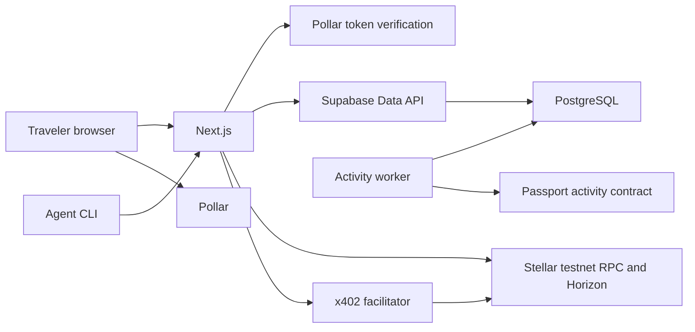
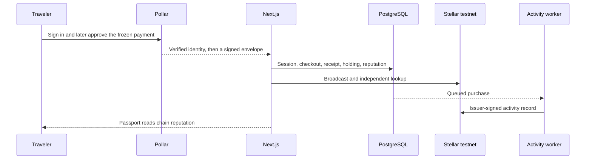
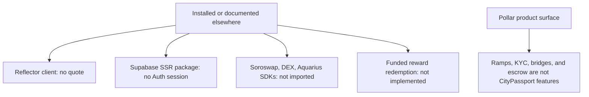

# Integration inventory

Source/package review: 2026-10-21. Integration diagrams added 2026-10-26 from the same source boundaries. Versions below are pinned repository versions, not a recommendation to upgrade. Installed package presence alone does not mean a feature is wired or remotely accepted. Flow detail is in [technical flows](TECHNICAL_FLOWS.md).

## How the systems connect

Pollar proves Google identity and signs with the managed wallet. Next.js checks that proof, freezes each checkout, and verifies Stellar itself. PostgreSQL stores the authorized business result. The activity contract publishes counters for verified registrations, purchases, and stamps. It does not receive USDC. The facilitator is used only by the agent purchase rail.

Reflector is installed and has no runtime call, so it is not on this path. There is no direct Soroswap SDK and no `SOROSWAP_API_KEY`. Swap venues, when present, are opened through Pollar.

## One pass across the boundaries

A balance in Pollar, an explorer link, or a facilitator status does not replace the receipt. The displayed reputation comes from the activity contract after that record confirms. Until then the passport shows the activity as pending or unavailable.

## What stays outside the runtime path

## Package inventory

| Product/package                                  | Current use                                                      | Main source                                           | Verification boundary                                                              |
| ------------------------------------------------ | ---------------------------------------------------------------- | ----------------------------------------------------- | ---------------------------------------------------------------------------------- |
| Pollar `@pollar/react` 0.11.5                    | Google login, managed wallets, signing, wallet/swap modals       | `src/components/wallet/`, `src/app/pollar-actions.ts` | Login/wallet reads and funded testnet pass recorded; funded swaps pending          |
| Stellar SDK 17.2.1                               | Classic testnet USDC XDR, signatures, RPC, fee-bump verification | `src/lib/payments/stellar.ts`                         | Settlement recovery recorded; mainnet unsupported                                  |
| Stellar RPC                                      | Account read, broadcast, independent lookup                      | Testnet URL in payment adapter                        | Provider retention/outages limit lookup; no background reconciler                  |
| Horizon                                          | Buyer/recipient testnet balance and trustline preflight          | Payment adapter and recipient validators              | Snapshot preflight is not settlement proof                                         |
| StellarExpert                                    | Transaction/ledger evidence links                                | `src/lib/payments/explorer.ts`                        | Navigation aid; never the receipt authority                                        |
| Reflector client 2.2.0                           | Dependency only                                                  | `package.json`, lockfile                              | No application import, feed, quote, or settlement role                             |
| Stellar DEX / Aquarius / Soroswap                | Provider-configured swap venue choices through Pollar            | `getSwapConfig`, `openSwapModal`                      | No direct venue SDK; available routes/liquidity are provider/network-dependent     |
| Supabase JS 2.117.3                              | Data API/RPC using publishable key and app capability            | `src/lib/supabase/server.ts`                          | PostgreSQL is application persistence; memberships/RLS authorize data              |
| Supabase SSR 0.12.7                              | Installed historical dependency                                  | `package.json`                                        | Current custom-session client uses `supabase-js`, not a Supabase SSR OAuth session |
| Next.js 16.4.3 / React 19.3.0                    | Server pages/actions and focused browser interactions            | `src/app/`, `src/components/`                         | Web application, no separate service backend                                       |
| next-intl 4.14.9 / Zod 4.6.5                     | Localization and untrusted-input validation                      | `messages/`, domain validators                        | PostgreSQL repeats critical invariants                                             |
| Three.js 0.186.1                                 | Optional landscape/stamp visuals                                 | `src/components/experience/`                          | Visual preview only; never issues claims                                           |
| PGlite 0.5.8 / Vitest 4.1.11 / Playwright 1.64.0 | Embedded DB, unit, browser validation                            | `scripts/test-db.ts`, `tests/`                        | Test tools, not application persistence                                            |
| Soroban SDK 29.0.1 (Rust)                        | Deployed testnet activity mirror                                      | `contracts/passport-activity/`                        | Automatic issuer-funded registration and durable worker; real pass activity confirmed on testnet                               |

Pollar's upstream product supports more capabilities than CityPassport uses. Bank ramps, KYC flows, external-wallet integrations, cross-chain bridges, escrow, and sponsored operations beyond the actual signing flow must not be advertised as implemented merely because the provider offers them. This repository has no direct `@soroswap/sdk` dependency or configured `SOROSWAP_API_KEY`.

## Responsibilities

Pollar supplies provider identity verification and managed wallet consent/signing. CityPassport supplies application sessions, business authorization, checkout invariants, independent payment checks, and fulfillment. Stellar establishes ledger settlement. PostgreSQL stores authorized business state. A provider balance, explorer link, swap quote, or optimistic callback cannot replace a verified receipt.

Reflector would provide reference prices if implemented; it would not execute swaps, guarantee USDC parity, prove liquidity, or confirm a purchase. The current fixed-USDC checkout does not require an oracle. [Reflector design](REFLECTOR_INTEGRATION.md) and [swap guide](SWAPPING.md) explain the separation.

## Primary references

Reviewed on 2026-10-21 where retrievable: [Pollar upstream](https://github.com/pollar-xyz/pollar), [Stellar RPC transaction lookup](https://developers.stellar.org/docs/data/apis/rpc/api-reference/methods/getTransaction), [Reflector contract interface](https://github.com/reflector-network/reflector-contract), [Reflector JS client](https://github.com/reflector-network/contract-client-js), [Soroswap contracts](https://github.com/soroswap/core), and [Supabase RLS](https://supabase.com/docs/guides/database/postgres/row-level-security).

Pollar's documentation bundle could not be retrieved through the web reader during this update; API details were checked against repository source and installed 0.11.5 declarations. Reflector's website required JavaScript, so its official repositories and installed declarations supplied the interface reference. No live integration was executed for documentation verification.
