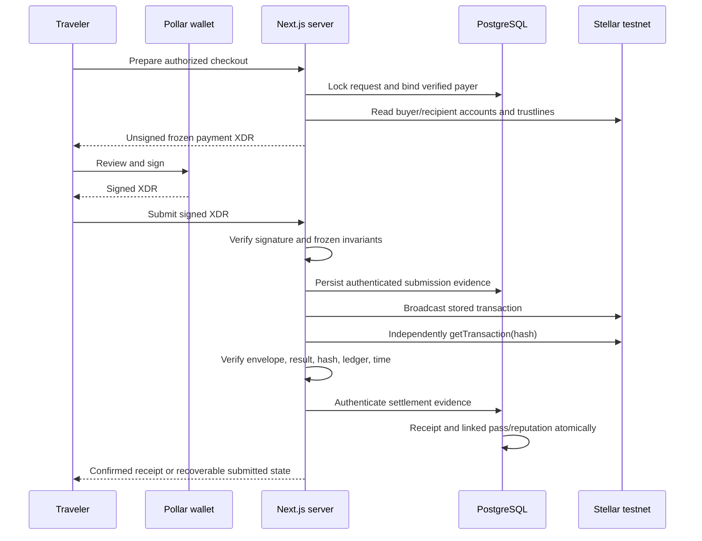
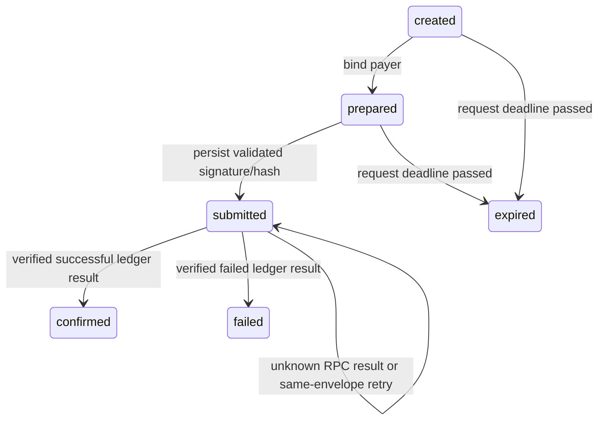

# Stellar integration and settlement

Source reviewed 2026-10-21. This guide describes the application adapter, not every capability of Stellar or Pollar. See [Pollar sessions](POLLAR_INTEGRATION.md), [checkout API](API_REFERENCE.md), and [swaps](SWAPPING.md).

## Network, asset, and units

| Setting            | Current implementation                                                                            |
| ------------------ | ------------------------------------------------------------------------------------------------- |
| Payment network    | Testnet only; `Networks.TESTNET` for XDR construction and verification                            |
| RPC                | `https://soroban-testnet.stellar.org`, 10-second SDK timeout                                      |
| Horizon            | `https://horizon-testnet.stellar.org`, no-store account reads with 10-second timeout              |
| Payment asset      | Classic `USDC` with issuer `GBBD47IF6LWK7P7MDEVSCWR7DPUWV3NY3DTQEVFL4NAT4AQH3ZLLFLA5`             |
| Amount encoding    | Decimal strings, at most seven fractional digits; exact scaled `bigint` comparison                |
| Current pass price | Exactly 100 testnet USDC; fixed by database constraint                                            |
| CityPass recipient | Owner-authorized public address in `src/lib/passes/program.ts` and private treasury configuration |
| Signing            | Pollar managed Stellar wallet with prompt confirmation                                            |

The wallet network is derived from Pollar's publishable-key prefix. Checkout separately restricts network/asset in TypeScript and PostgreSQL. A mainnet Pollar key cannot bypass that boundary. Asset identity is **code plus issuer**; an unrelated token named USDC is rejected. Testnet tokens do not establish real-money purchase readiness.

`amountToStroops` in `src/lib/payments/validation.ts` parses a positive decimal into seven-decimal integer units and enforces the signed 64-bit maximum. It rejects exponent notation, negatives, excess decimals, and zero. Prices are not converted using floating point or Reflector.

## Transaction path

`buildCheckoutTransaction` requires a prepared request with a payer and unexpired deadline. Horizon preflight checks the exact issuer, authorization, available payer balance after selling liabilities, and recipient capacity after buying liabilities. Missing payer account yields `account_unfunded`; insufficient authorized USDC yields `insufficient_usdc`; recipient inability yields `recipient_unavailable`. These reads can become stale; Stellar settlement remains authoritative.

The builder fetches the payer sequence from RPC, uses `BASE_FEE`, adds exactly one classic payment and the request nonce as `Memo.hash`, and sets maximum time to checkout expiry. No swap, contract invocation, arbitrary recipient, or caller-selected award is added.

## Signed envelope verification

`verifyCheckoutEnvelope` parses XDR under the testnet passphrase and validates:

- A normal transaction or the inner transaction of a fee-bump envelope.
- Exact verified payer as source and no conflicting operation source.
- Exactly one payment to the frozen destination.
- Exact asset code/issuer and exact integer-scaled amount.
- Hash memo equal to the 32-byte request nonce.
- Positive safe maximum time no later than checkout expiry.
- A valid payer signature over the inner transaction hash.

The returned submission hash is the parsed envelope transaction hash, including the outer fee-bump hash where present. The server records hash/envelope and signed evidence before broadcast. It does not accept a provider's success callback as proof.

## Independent settlement evidence

`verifyCheckoutRpcResult` accepts only terminal `SUCCESS` or `FAILED`, validates a 64-character hash and safe positive ledger/timestamp, verifies the returned envelope, and matches the stored request hash. RPC `createdAt` may arrive as decimal text; Zod normalizes safe integer seconds. Fee-bump success additionally requires inner success. Successful close time must be within request expiry and no earlier than creation minus the implemented 30-second allowance.

`recordEvidence` HMAC-authenticates JSON using the backend bridge key and the exact domain prefix `citypassport-payment-evidence-v1\n` (a newline separator). PostgreSQL rechecks the actor, MAC, request snapshot, transition, and transaction uniqueness under lock. Browser-supplied JSON without a valid server MAC cannot create a receipt. This backend key is unrelated to wallet custody; compromise would affect the trusted evidence boundary and must be treated accordingly.

Receipt insertion and linked pass fulfillment share one transaction. A uniqueness/fulfillment failure rolls back the receipt too. Claims, immutable receipts, pass holdings, and reputation are not written directly by the browser. Public explorer links aid inspection but never authorize fulfillment.

## Recovery state machine

Pass purchases start already prepared. `NOT_FOUND` does not prove failure. The page checks after two seconds, then at five-second intervals for up to twelve checks; manual check/retry remains available. Retry uses the stored envelope/hash and cannot change amount or recipient. Timely settlement can be reconciled after the QR has expired. An already submitted payment is not marked expired just because wall-clock time passed.

There is no background reconciliation worker. Stellar RPC keeps bounded history, so old unknown submissions need an explicit operational investigation and potentially a longer-history source. Do not manufacture receipt evidence or issue a replacement charge based on a missing lookup. [Stellar's transaction lookup reference](https://developers.stellar.org/docs/data/apis/rpc/api-reference/methods/getTransaction) documents statuses, timestamp encoding, and retention.

## Testnet activity contract

`contracts/passport-activity/src/lib.rs` is deployed on Stellar testnet. It automatically records verified passport activity and is the displayed reputation authority. It is not the USDC payment recipient.

| Method                     | Authority and behavior                                               |
| -------------------------- | -------------------------------------------------------------------- |
| `__constructor(issuer)`    | Sets trusted attester and initial pause state                        |
| `register(user)`           | Issuer authorization; initializes public passport counters             |
| `set_paused(paused)`       | Issuer authorization; gates new attestations                         |
| `record(event_id, record)` | Issuer authorization, active user, replay/conflict/collection checks |
| `activity(user)`           | Reads stored counters                                                |
| `tier(user)`               | Computes 0/1/2 at 0/80/240 reputation                                |

Record kind 1 adds 80 reputation and one purchase per wallet/destination; kind 2 counts a unique stamp without awarding reputation; kind 3 counts a completed redemption subject, without funding or executing redemption. Identical event replay is harmless; conflicting reuse and duplicate collections fail. TTL extensions occur on writes/retries; archived entries require restoration. No email, guest data, raw token, or personal payload belongs in an attestation.

The revised automatic contract was deployed on 2026-10-25 with SDK 29.0.1 on protocol 29. A private transactional outbox queues verified Pollar profiles, confirmed holdings and accepted stamp claims. The app starts an issuer-funded publisher with signed RPC commands, exclusive database leases, replay protection, fee caps and automatic retries. The passport reads contract counters and shows pending/unavailable state without substituting database awards. No activation prompt or manual sync exists. Two real existing purchases were automatically confirmed as 160 reputation. See [operations](ACTIVITY_CONTRACT.md).

## Evidence and remaining work

The 2026-10-17 verification log records a funded Pollar fee-sponsored pass payment, successful independent settlement, recovered receipt, one holding, and +80 reputation. Later passport inspection records two holdings/160 reputation. Those are historical observations, not new balance assertions. Mainnet, funded swaps, multi-user acceptance, independent-connection races, refunds/reversals, and unattended operations remain separate gates. The activity deployment and isolated testnet verification are recorded separately in [activity operations](ACTIVITY_CONTRACT.md).
