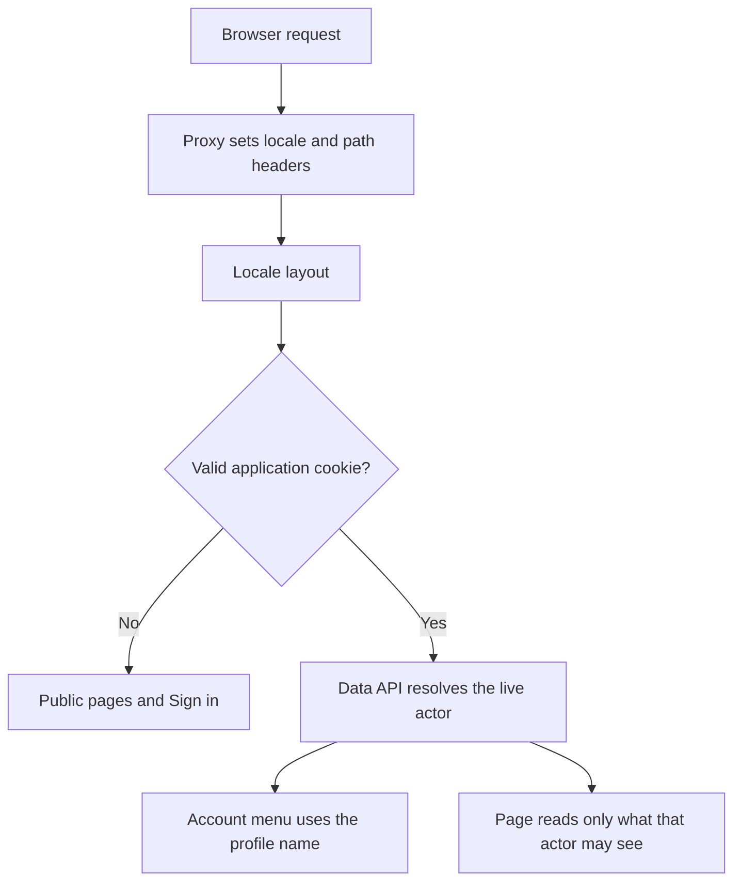
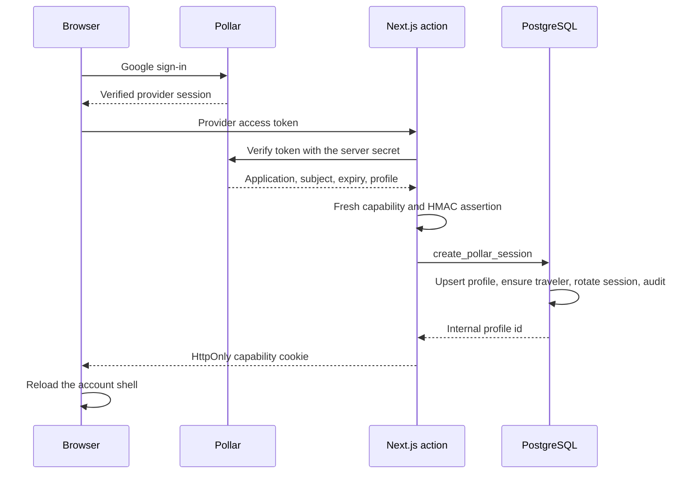
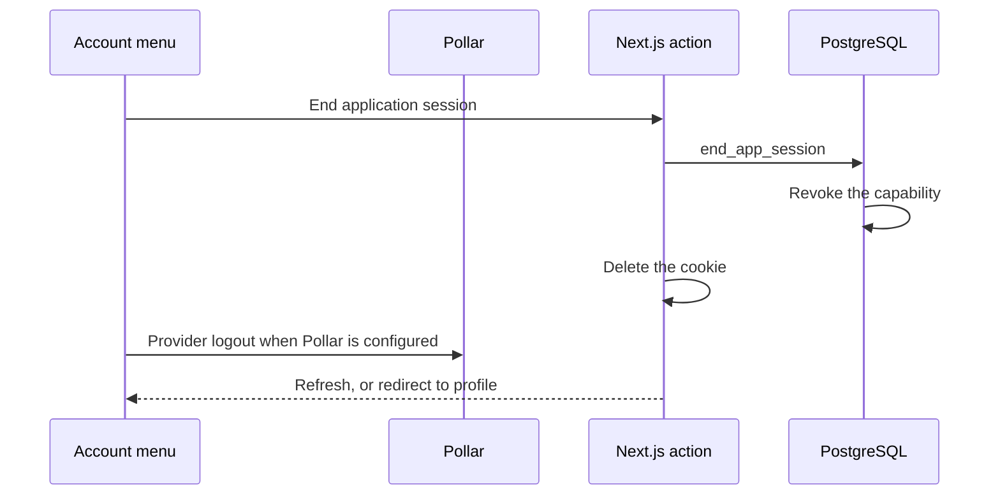
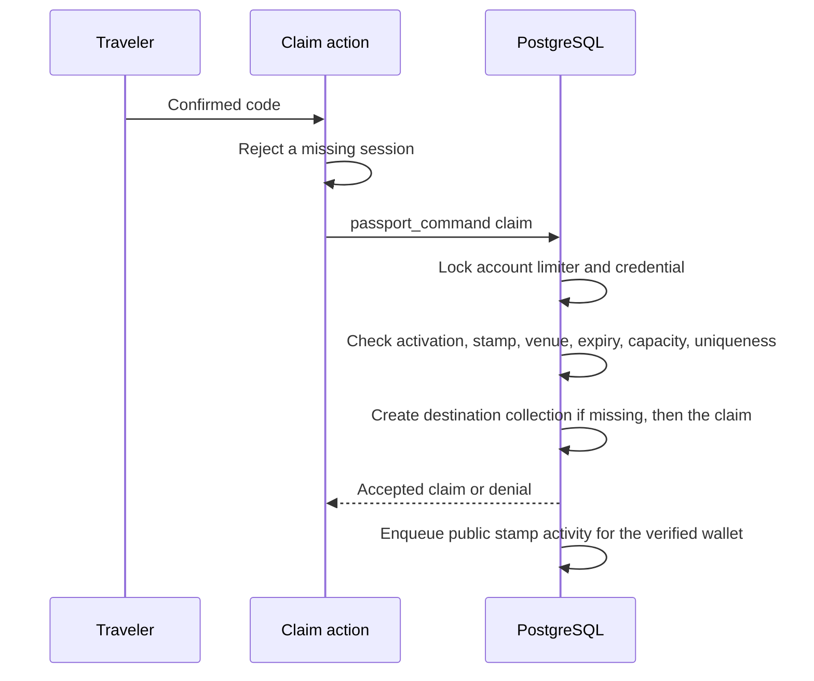
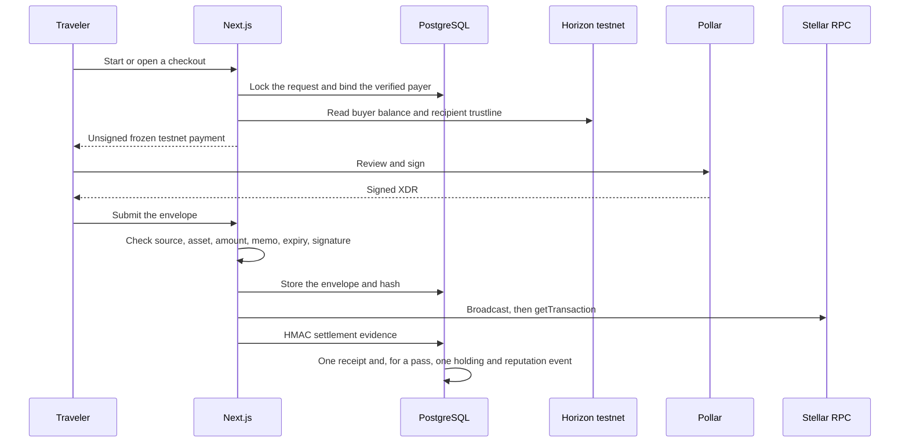
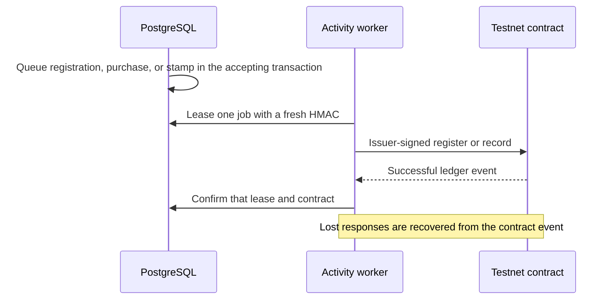
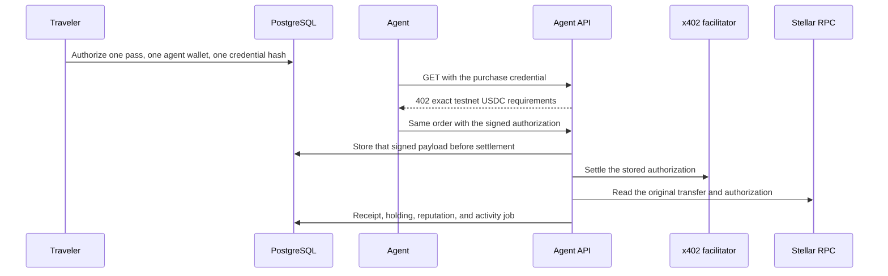
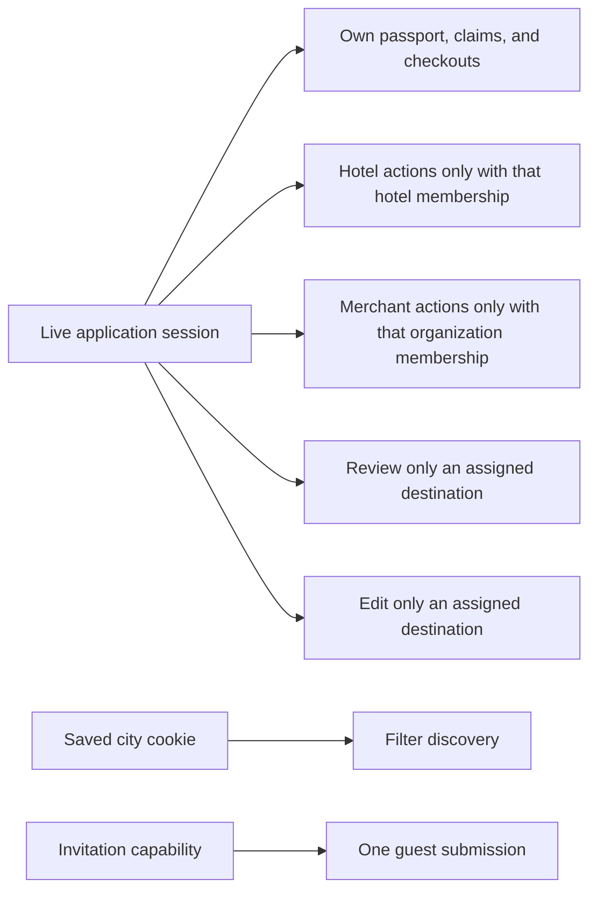

# Technical flows

Source reviewed 2026-10-26. These sequences describe the implemented server path. They omit secrets, tokens, guest payloads, and raw credentials. Protocol detail remains in [Pollar](POLLAR_INTEGRATION.md), [Stellar settlement](STELLAR_INTEGRATION.md), [activity operations](ACTIVITY_CONTRACT.md), [x402](X402.md), and [authorization](AUTHORIZATION.md).

## Request shell

`src/proxy.ts` overwrites internal routing headers and sends `Cache-Control: private, no-store`. The layout reads the cached session to choose the account control. A cookie that does not resolve to a live profile is treated as signed out. Membership is read from database tables during the action that needs it. It is not copied into the cookie.

Language links keep the current public path. They drop credential query parameters. They do not carry a guest invitation fragment.

## Pollar session exchange

The browser cookie is a random 256-bit capability. PostgreSQL stores its hash. The provider token, the HMAC key, and the raw capability are not written to public tables or logs. The session ends at provider expiry or one hour, whichever is earlier. A replayed assertion rolls back. Profiles match `pollar_application` plus `pollar_subject`. Email does not merge a legacy account.

Later Data API calls send the capability in `x-citypassport-session`. `private.current_actor()` accepts only a live, unrevoked hash. Direct client writes to claims, receipts, invitations, memberships, and the ledger stay closed.

## Sign-out

The client waits for an in-flight token exchange before logout, so an older exchange cannot recreate the session. When Pollar is not configured, the server action still ends the database session and redirects to profile. Profile then shows the sign-in gate.

## Visit claim

The fragment token is hashed before storage. Invalid codes count toward the account limit and create no stamp. Exploration-guide claims use `claim_exploration` and are labeled as guide stamps. They do not pass the venue-QR checks and they do not add reputation.

## Destination pass and merchant checkout

Both rails use classic testnet USDC. The server freezes recipient, issuer, amount, memo nonce, and deadline. A provider callback is not a receipt. Unknown RPC results stay submitted. Retry resubmits the stored envelope. The state machine and exact XDR checks are in [Stellar integration](STELLAR_INTEGRATION.md).

A pass receipt also inserts one holding and +80 reputation in that same transaction. Merchant checkout does not do that unless the request belongs to a pass order. The buyer wallet must differ from the treasury wallet.

## Automatic activity publishing

The traveler does not sign registration. The issuer pays the fee. Purchase events add 80 reputation. Stamp events add a stamp and no reputation. The passport page reads those counters from Stellar. A failed read shows unavailable and does not fall back to the PostgreSQL reputation journal. The worker runs beside `npm run dev` and `npm run start`. If the worker stops, the app stops, and the queue keeps the unpublished events. Browser tests disable the worker.

## Agent purchase

The credential is not the application session. Classic checkout actions cannot spend an x402 order. A lost response can be bound only to the original transaction hash. A second payment is refused while settlement is unknown. This path is implemented and locally enabled. A funded agent purchase remains unverified. See [x402](X402.md).

## Who may do what

The city cookie, a profile row, and a Pollar wallet do not grant hotel, merchant, review, or editor rights. Guest pre-check-in is the invitation exception: the guest proves the token and the reservation email, and cannot read the reservation. Reviewers cannot review their own organization. Editors must withdraw a published experience before changing it.
