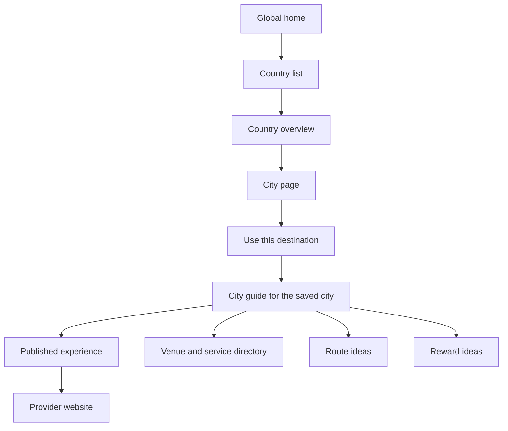
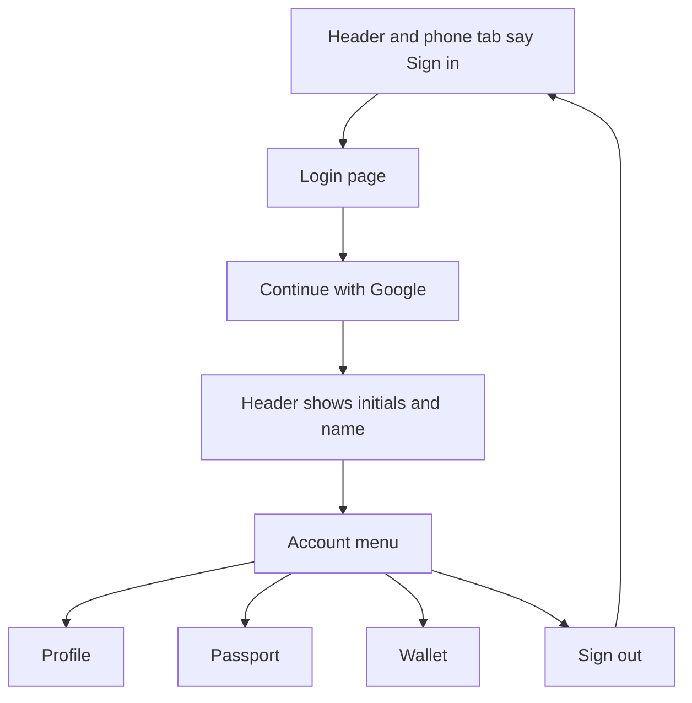
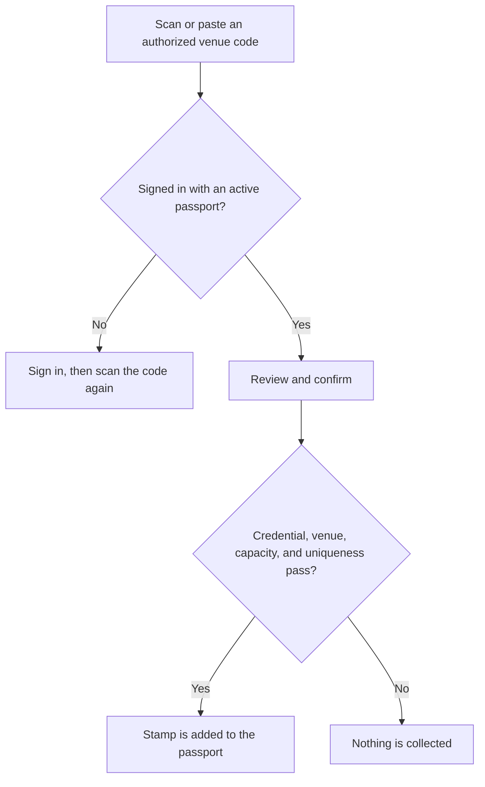
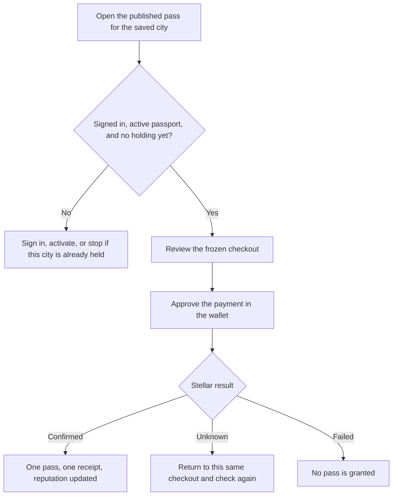
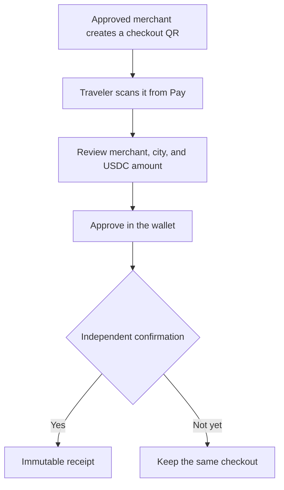
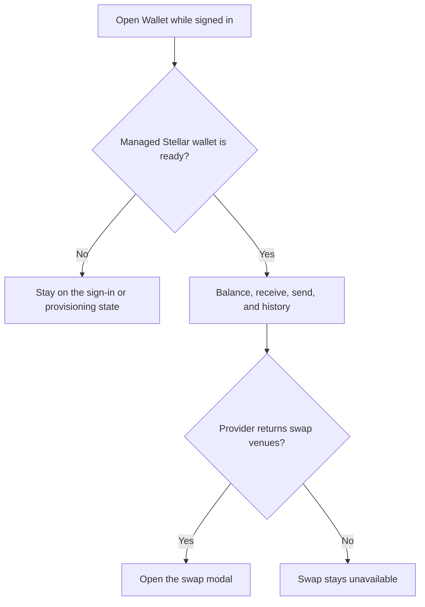
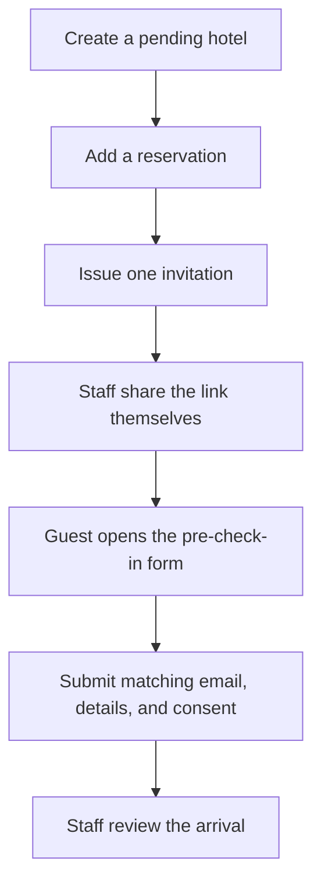
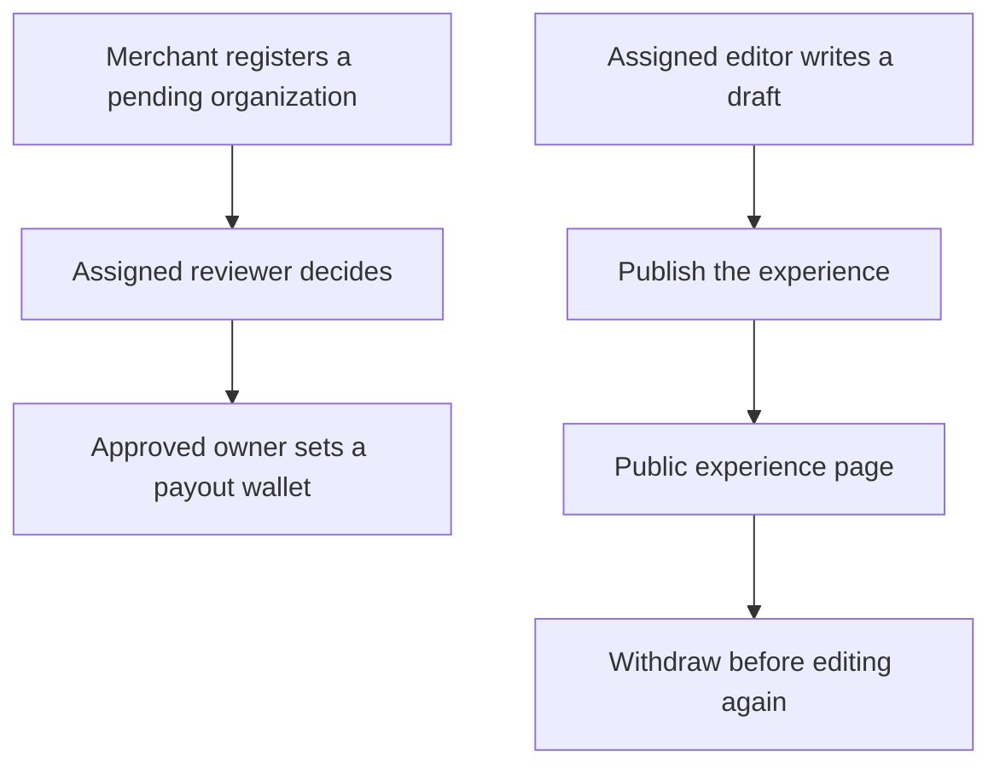
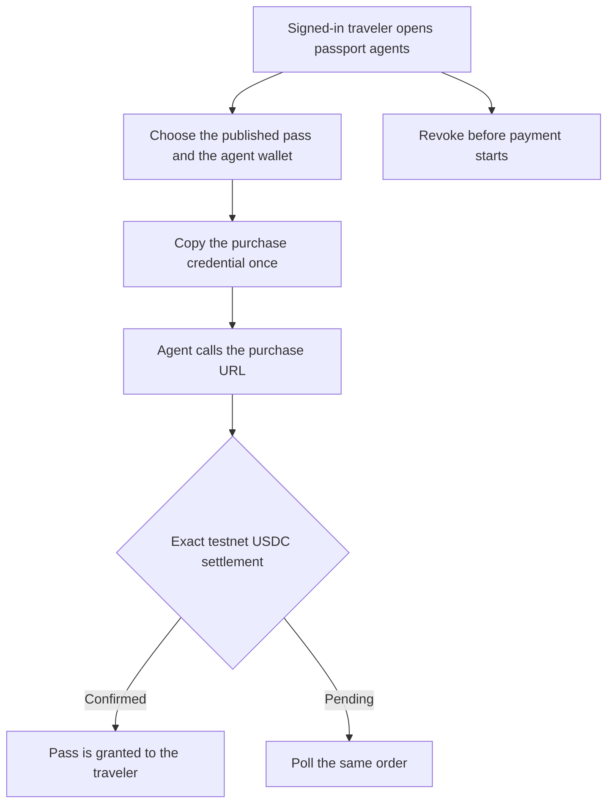

# User flows

Source reviewed 2026-10-26. These diagrams follow the routes a person can use today. They do not add partners, prices, or acceptance that the feature guides do not already record. Route detail stays in [application flows](APPLICATION_FLOW.md). Session, payment, and publishing mechanics stay in [technical flows](TECHNICAL_FLOWS.md).

Replace `[locale]` with `es`, `en`, or `pt`.

## Discover a destination

Home does not depend on a saved city. Choosing a city stores `citypassport_destination` and filters later discovery. That cookie is a browsing preference, not staff access and not a passport stamp. Listings and external links are references. They do not confirm a partnership, a vacancy, or a booking. Route bookmarks and reward interests stay in the browser. They are not account records and they do not redeem anything.

The phone tab bar covers home, passport, destinations, wallet, and account. A second row for the city guide, venues, routes, and rewards appears on those journeys.

## See whether you are signed in

Until a database session exists, the header and the last phone tab both say **Sign in** and open `/[locale]/login`. After login, the header shows initials and the traveler name, or the email name when no display name is stored. The menu opens profile, passport, and wallet. **Sign out** ends the application session and returns the header to **Sign in**.

The green passport button is separate. It offers a passport to a guest, opens the passport for an active account, and offers activation only when that account is known to be inactive. A failed account lookup does not invite an existing traveler to create another passport.

Profile still holds traveler links and, behind a closed disclosure, hotel, merchant, operator, and review workspaces. Opening one of those pages does not grant the role.

## Collect a visit stamp

Open `/[locale]/claim`. The camera recognizes a code; it does not submit until the traveler confirms. The code lives in the URL fragment and is removed from history after use. Sign in before scanning again. Do not keep the credential through the Google redirect.

A valid code records one visit for that stamp. It does not prove the person was physically present, and it does not pay a merchant. Guide stamps collected from a city page are labeled separately in the passport. They are not venue QR claims.

## Buy a destination pass

The development offer is exactly 100 testnet USDC. Settlement adds 80 non-transferable reputation. The pass does not include venue admission, a discount, or a reward that can be spent. One traveler can hold a destination once. There is no renewal or refund in the product.

If the network lookup is interrupted, the traveler uses the passport's recent purchase and the original checkout. A new payment is not the recovery path. A recorded funded testnet purchase is historical evidence in [verification](VERIFICATION.md), not a new balance checked for this page.

## Pay a merchant

`/[locale]/pay` accepts a CityPassport checkout. A merchant payment follows the same confirmation rule as a pass and does not by itself create a destination-pass holding. Pending organizations cannot take payment. Wallet send and swap are separate and do not complete a checkout.

## Use the travel wallet

Balances come from the wallet provider, not from a sum of CityPassport receipts. A swap quote is not a completed exchange. Funded swap execution is still unverified. Card top-ups are not offered.

## Prepare a hotel arrival

The guest does not need a passport account. The form cannot look up the reservation. Staff move a submission from submitted, to reviewed, to ready for arrival, to completed. Cancellation invalidates invitations. CityPassport does not email the link. Hotel records stay inside that hotel's authorized staff.

## Review a merchant or publish an experience

Review and editing are different assignments. A hotel owner, a merchant member, and a signed-in traveler do not receive either role by signing in. Review covers approve, suspend, and reactivate with a reason. Public experience pages show published records only.

## Authorize an agent to buy a pass

This rail is enabled in the approved local development setup. The agent uses its own purchase credential, not the traveler's session cookie. A funded agent purchase has not been verified. Unknown settlement does not start a second charge. See [x402](X402.md).

## Outside these flows

Inquiry pages return 404. Reward redemption, refunds, mainnet checkout, automatic route awards, and unattended retention are not available. Signing in never creates an organization membership or a destination assignment.
